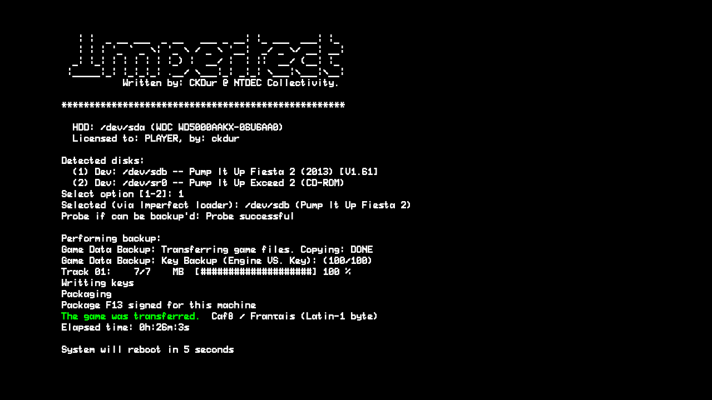

Common Instructions
~~~~~~~~~~~~~~~~~~~

This feature simplifies the process of transferring games by guiding the user
through disk and dongle detection, game copying, and system update steps.

To use the Importer, follow these steps:

1. **Open the settings menu.** More info can be found in :ref:`settings_section`
section.

2. **Select the option:** Go down to the **"The Game Transfer Feature!! 
(A.K.A Import)"**.

3. **Browse the list of installable games.**

A list containing all available games that can be installed will appear on the
screen.

4. **Select the desired game.**

Remember to connect the game original disk. (SATA to USB, and SATA-only are ok).
If the game has a dongle, connect that also.

5. **Importer screen activation.**

The Importer will start and attempt to **detect required disks and dongles**
for the selected game.

.. note::

   The importer may not detect the games right away. You can retry as many times
   as you want stepping in the "center" button. To abort, just step on "red".

The Importer runs in its own full-screen console: white text on black, with
an empty border around it, the same on every monitor or TV. The text always
fills 30 lines of the screen height, so it is as readable on a 4K monitor as on
an old 4:3 TV (where the lines are 80 characters wide; on a 16:9 screen they
are 106). Nothing is ever written up to the edge of the screen.

The Importer reads the pads (and the keyboard keys mapped to them) itself:
center step to continue, red keys to cancel, and the same arrows that move
through the menu list to choose among numbered options.

6. **Insert the required disk or dongle.**

- If the disk is detected successfully, the system will begin with **the backup
  of game data** automatically.

7. **Wait for the process to finish.**

- The copying process may take some time depending on the game size.
- Do not interrupt power or eject media during the operation.

8. **System reboot.**

Once the installation is complete, the system will **automatically reboot** to
finalize the setup.

9. **Verify the game installation.**

After rebooting, the newly installed game should appear as a new entry in the
main menu.

Notes
^^^^^

- Each game may have **unique installation requirements or detection methods**.
  Always follow any specific prompts displayed on the Importer screen. Specifics
  of the installation will be explained in further sections.

- Ensure disks and dongles are **clean and properly connected** to avoid
  installation failures. Failures on the SATA cable or poor USB connection can
  interrupt the process.

- If a game fails to install, retry the process from the beginning.

The specifics for each type of game are written in the following sections.
If there are some troubles in your installation process, please refer to the 
specifics of each game type.
