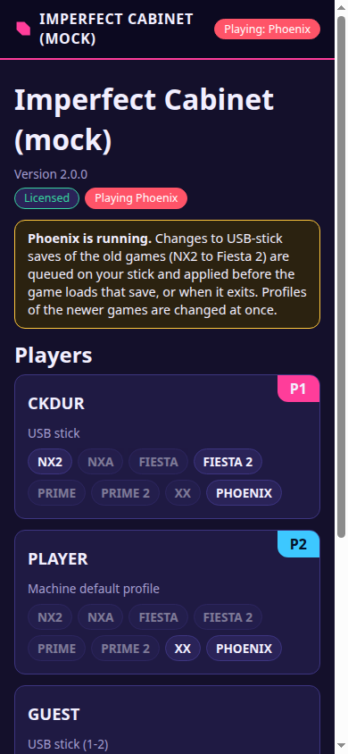
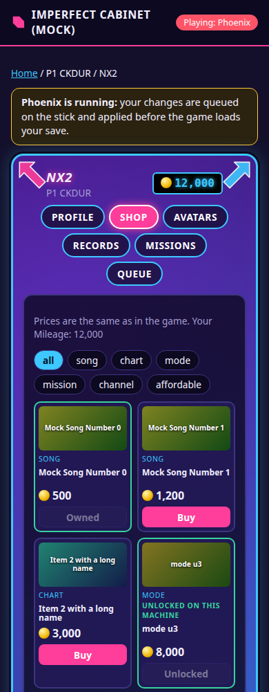
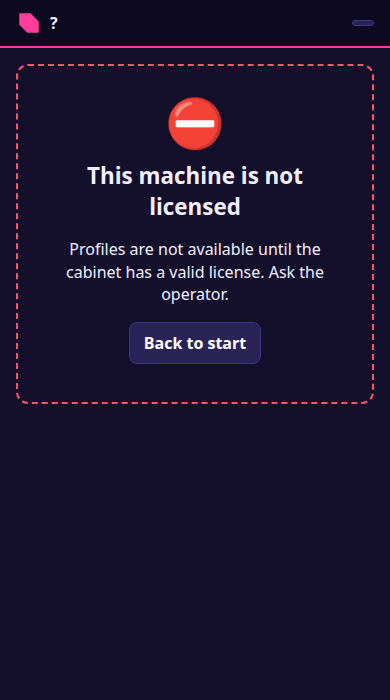

.. _online_web_section:

Profile manager
~~~~~~~~~~~~~~~

The cabinet serves a web page where you see and edit your profile from a
phone, in the spirit of PumBi (the desktop tool of the Fiesta era) and the
*My Page* of the piugame site. It works for NX2 up to Phoenix, on your USB
stick or on the machine's profiles.

Opening it
----------

1. Press **F8** on a keyboard plugged into the cabinet, in the menu or in any
   game.
2. A QR code labelled *Profile manager* appears in the side bar of the picture
   for 10 seconds (pressing F8 again restarts the time).
3. Scan it with a phone that is on **the same network as the cabinet**.

The page lists the players now on the machine (P1 and P2: the stick in their
port, else the machine's default profile, plus other sticks and cards) and, for
each, the games that have a profile. The key, the time and the place of the
code can be changed in :ref:`online_web_ini_section`.

The page is always on and **open to anyone on the network**: see the warning
in :ref:`online_web_ini_section`.

What each game offers
---------------------

**NX2 and NX Absolute**
  A page in the style of PumBi:

  - **Shop.** Songs are bought with your mileage at the game's own prices;
    prices are the same as in the game. A song the machine already unlocks
    (by its own total mileage, see below) is marked and cannot be bought.
  - **Hidden charts** are not sold: as in the game they come from World Max
    missions only.
  - **Avatars** are free: choose any, shown with the game's own pictures.
  - **Missions.** The World Max missions, with which ones are done, as a
    **map** or a **list** (the switch above them). The map is the game's own
    World Max map with a mark on every mission: green when cleared, yellow
    when it can be played (a neighbour is cleared), grey when still locked,
    and the paths between missions. NX Absolute has its world map plus the
    maps of its lands (WestPalZ and the space zones). Phantomia missions show
    once played. Tap a mission to see it; drag, pinch or use the buttons to
    move and zoom.
  - **Records.** Your best scores.

**Fiesta and Fiesta EX**
  A **PP shop** of Quest World items. PP is earned by leveling up. The game
  never stored PP and the server that handled them is gone, so *the amounts
  are invented*: the rule "PP comes only from levels" is the original one, the
  numbers are not. What you spent is written to a ledger file on the stick
  (``ntdec/rewards_fiesta.json`` or ``ntdec/rewards_fex.json``): deleting it
  gives the PP back.

  **Missions**: the Quest World missions as a **map** of the game's hexagon
  zones (Mission Zone, the Hell zones, Skill Up, Co-op, Heaven) or a **list**.
  Each mission shows its song, kind (Single, Double, Co-op, Skill Up), how
  often it was played and the best grade; cleared ones are green. Warp
  hexagons open the zone they lead to. What a mission asks of you is not
  shown: the game keeps it in a form not read yet.

**Fiesta 2**
  **Rewards** are claimed by level and by mission count, as the REWARD button
  of PumBi did: charts, Music Train slots and the music tempo and skin
  options. Nothing is bought: a reward is claimable once its level or mission
  count is reached. The **missions** are listed as for Fiesta EX (Fiesta 2
  has no mission map).

**Prime, Prime JE, Prime 2, XX and Phoenix**
  A *My Page* in the style of the piugame site: your **name**, **avatar**,
  **title** and your **best scores**. These are written to your
  ``profile.ini`` (:ref:`format <online_profile_ini_section>`) at once and
  the game uses them at the next login. Scores are only shown: the page never
  changes them.

  - **Quests** (Prime, Prime 2, XX): the Quest Zone, with each quest's goal
    as the game words it, your plays and best grade. XX also tells cleared
    from failed; Prime and Prime 2 do not report that to the machine, so
    there only plays and grades are shown.
  - **Titles** (XX, Phoenix) are shown by name, with what earns them. A title
    is **earned**: the machine's game server checks every song you play
    against the title's rule and keeps the titles you earned in your profile.
    Only earned titles can be chosen (plus BEGINNER in Phoenix and "no title"
    in XX). Titles whose rule the machine cannot check (tournaments, staff,
    rankings, ...) cannot be earned here; the rules come with the updates,
    and requirements marked *unconfirmed* come from fan sources about the
    original game. A new Phoenix profile starts as BEGINNER.

Song names and banners are read from the game's own data on the machine when
the page is shown; nothing of the games is on the page's server or in this
manual. The first time after an update, a game's list is built in the
background (:ref:`troubleshooting <online_trouble_section>`); it is kept
encrypted in ``/SETTINGS/piuweb`` and tied to this machine.

Names
-----

On Fiesta, Fiesta EX and Fiesta 2 the name is **4 to 8 letters or digits and
begins with a letter**. NX2 and NX Absolute names have up to 12 characters.
The other games follow ``profile.ini`` (up to 12 characters).

When your changes take effect
-----------------------------

The games of the older family (NX2 to Fiesta 2) keep their save on the stick
and read it when they load. So a change made while that game is running is
**queued** on the stick (``ntdec/pending/``) and **applied before the game
next loads the save**, or when the game exits. If no such game is running,
it is applied at once. Before every change the old save files are kept in
``ntdec/backup/``. The page shows the queue and can clear it.

Prime to Phoenix read ``profile.ini`` at every login, so their changes are
immediate.

Whose profile it edits
----------------------

In this order: the profile on a **stick** in a player's port, then the
machine's **default profiles** (left and right side) and the profile of
each **card**. The older games exist only on sticks: with the default
profile they say to insert your stick.

If the machine is not licensed the page shows only that
(:ref:`license_import_section`), and a game's page appears only when that game
is installed.

.. _online_web_cards_section:

Card profiles
-------------

A tapped AM.PASS card is a profile too. The page lists every card used on the
machine next to the sticks, and shows and edits its saves the same way
(:ref:`online_card_profiles_section`). On the older games the changes are
queued while the game runs and applied before it next loads that card's save,
like a stick's, with the queue kept in the card's folder
(``ntdec/pending/``) and the previous files in ``ntdec/backup/``.
